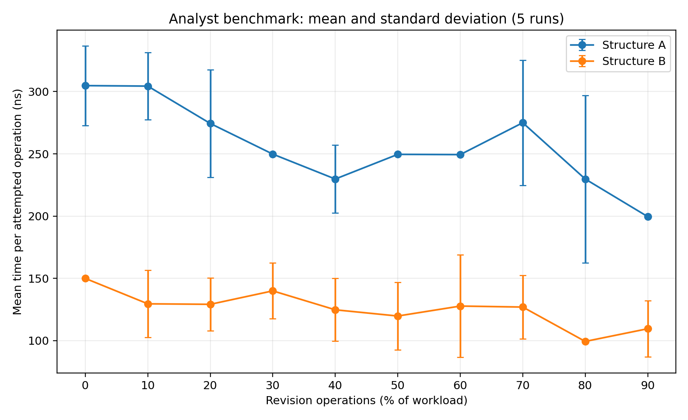
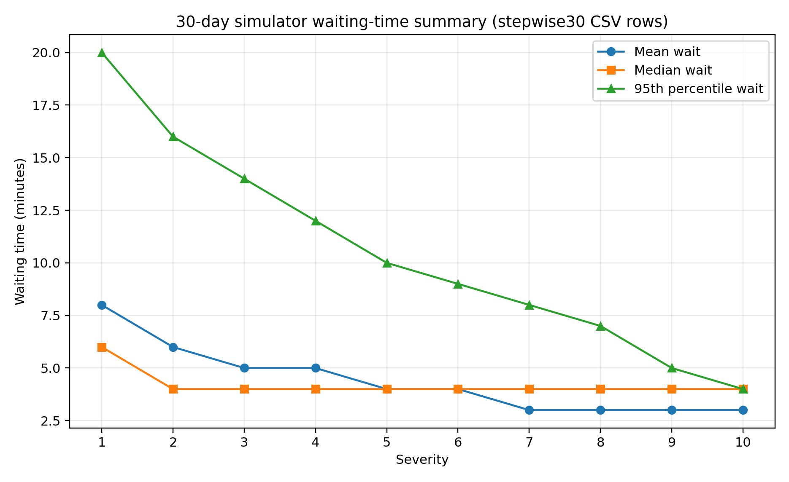
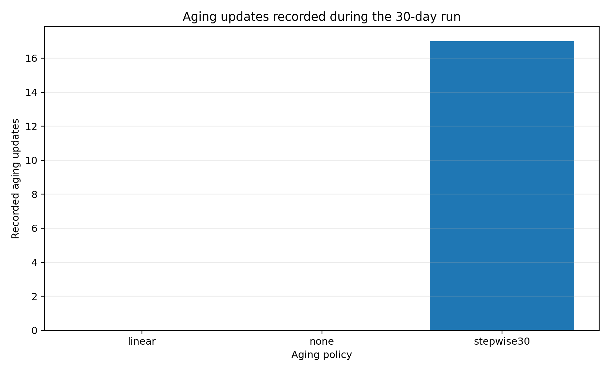
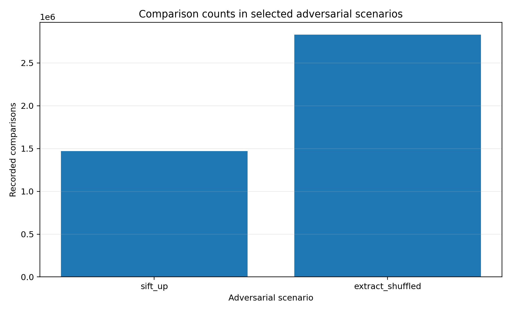
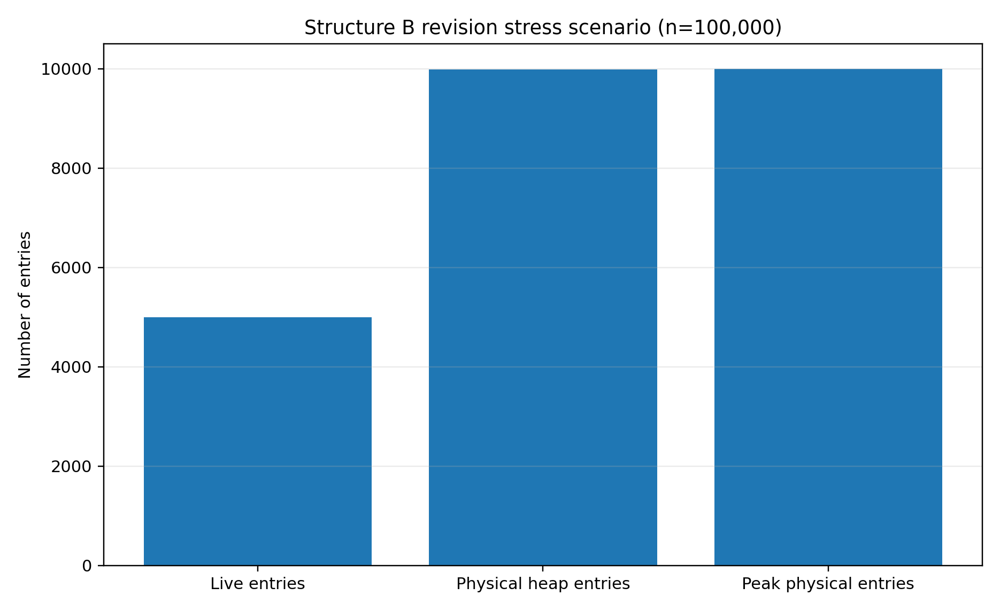

# Project 10: Emergency Triage Queue

## Technical Report

**Course:** CS 253 / MA 253 — Data Structures and Algorithms Laboratory
**Evidence cutoff:** repository state and outputs reported through 22 November 2026

## 1. Team and contributions

| Role | Team member | Roll number |
|---|---|---|
| Structure A | Ankit | 250041003 |
| Structure B | Kethavath Mothilal | 250001039 |
| Architect | Abhishek Bairwa | 250001002 |
| Oracle | Abhimanyu Kumar | 250002005 |
| Adversary | Sunil Mudavath | 250001049 |
| Analyst | Harshwardhan Mukhedkar | 250041017 |

The project is organized around the six roles specified for Project 10. The repository contains derivation documents for Structure A, Oracle and Analyst as well. The final README team table should be treated as the authoritative source for every member's name, roll number, GitHub username and role; this report does not guess details that are not visible in the supplied records.

The role split follows the project specification: Structure A owns the indexed heap and locator; Structure B owns the lazy-invalidation heap; the Architect owns the shared interface and application integration; the Oracle owner supplies a simple reference implementation and differential testing; the Adversary owner develops stress workloads; and the Analyst develops the cost model and measurement harness. Each contributor should verify that the final Git history and pull requests accurately identify their work before tagging the submission.

## 2. Problem and application

Project 10 models a casualty-ward waiting queue. Each patient has an identifier, a severity-derived priority and an arrival time. While waiting, a patient's severity may be raised, a patient may depart before treatment, and waiting time may increase priority so that patients are not indefinitely postponed. The application replays a deterministic synthetic stream of arrivals, severity revisions, departures and service completions over thirty simulated days.

The core data-structure problem is to support insert, extract-min, decrease-key and delete-by-identifier while preserving deterministic tie-breaking. The project compares two implementations: an indexed binary min-heap with a separately implemented open-addressing locator table (Structure A), and a binary heap using lazy invalidation and version records (Structure B). An unsorted-array oracle provides a straightforward correctness reference. The application also evaluates no-aging, linear-aging and 30-minute stepwise-aging policies in the simulator outputs supplied for this report.

## 3. Interface and invariants

Both implementations expose the same logical priority-queue operations and use the same ordering convention. A smaller numeric key represents a more urgent patient. Equal keys are resolved deterministically by arrival time and then patient identifier. The exact shared declarations and field names remain defined in INTERFACE.md; that file, rather than this prose, is the contract for compilation and hidden tests.

For Structure A, the heap-order property must hold at every parent-child edge. The locator must map every live patient identifier to its current heap index, and the reverse relation must hold: for every heap position i, the locator entry for that node's identifier equals i. Every swap during sift-up, sift-down, and delete must update the locator consistently. Deleting an arbitrary patient requires locating its index, replacing it with the last heap node, removing the last slot, updating the moved patient's locator, and restoring heap order in the appropriate direction.

For Structure B, each patient's current version determines whether a heap record is live. A revision inserts a new record and makes the old record stale; a departure invalidates the current record. Extract-min discards stale roots until a current record is found. Compaction removes stale records when stale entries outnumber live entries. At completed operation boundaries, the intended size invariant is physical heap size no greater than twice the live count plus one. The supplied D2 derivation proves a bound of this form under the stated compaction rule.

The oracle scans an unsorted collection to find the next patient. It is intentionally simple rather than fast: its purpose is to make the expected result independent of the heap algorithms. Differential tests compare operation results and observable queue behavior among A, B and the oracle.

## 4. Structure A: indexed binary min-heap

Structure A stores each live patient exactly once in a binary min-heap. The heap array provides the priority ordering; a custom open-addressing hash table with linear probing maps patient identifiers to array indices. The locator is essential because decrease-key and delete-by-id would otherwise require a linear search.

Insert appends a new node, records its index in the locator, and sifts it upward. Extract-min returns the root, moves the final node to the root, removes the extracted identifier from the locator, updates the moved node's index and sifts downward. Decrease-key locates the node through the hash table, changes its key and sifts upward because the project operation improves priority. Delete locates the arbitrary node, replaces it with the final heap node and restores heap order; depending on the replacement key, the repair may move upward or downward. Bottom-up build-heap applies sift-down from the last internal node toward the root.

Expected operation costs are O(log n) for insert, extract-min and heap repair; O(1) expected locator lookup under suitable hash distribution; and therefore O(log n) expected for decrease-key and delete. Bottom-up build-heap is O(n), not O(n log n), because most nodes are near the leaves and have little height to travel. The D1 derivation in the repository is the formal proof artifact for the required build-heap and locator-assisted operation bounds.

The main engineering risk is consistency between the heap and locator. A heap can appear correctly ordered while its locator points to the wrong index, causing a later revision or deletion to affect a different patient. For that reason, locator consistency is a structural invariant, not merely an optimization. A simpler alternative would be to search the heap linearly for each identifier, but that would make key updates and arbitrary deletion O(n) and would not meet the intended indexed-heap design.

## 5. Structure B: lazy-invalidation heap

Structure B uses a binary heap but avoids finding and repairing an existing heap node on every revision. Instead, it inserts a fresh record with the improved key and advances the patient's version in a version table. The older record remains physically present but is stale. A record is accepted only if its version still matches the current version and the patient is still live. During extract-min, stale records are removed from the root until a valid record is found.

A departure invalidates the patient's current record. This makes deletion cheap in the immediate path, but stale records accumulate until they reach the root or compaction is triggered. When stale entries outnumber live entries, the heap is rebuilt from the current live records. This bounds physical storage relative to the live population and prevents stale records from growing without control.

The intended completed-operation bound is H ≤ 2L + 1, where H is physical heap size and L is the number of live patients. The D2 derivation uses the compaction threshold to show that stale entries cannot remain more numerous than live entries after a completed operation, with the additive allowance covering boundary details in the stated implementation. The amortised analysis charges occasional rebuilding against the stale records accumulated since the previous rebuild. Ordinary heap insertion and removal are logarithmic in physical heap size; the compaction work is spread across the operations that created the stale records.

This approach is attractive when revisions are frequent because it avoids a locator-based in-place update. Its trade-off is extra memory, stale-root cleanup and occasional rebuild latency. Structure B's performance therefore depends not only on the number of revisions but also on how many stale entries survive until extraction or compaction.

## 6. Aging policies and requirement beyond the lecture

The project specification highlights two different aging mechanisms. Under linear aging, the urgency of patient i is expressed as U_i(t) = s_i + c(t − a_i), where s_i is the severity score, a_i is arrival time and c is a common positive aging rate. For any two waiting patients i and j, the shared c·t term cancels when their urgencies are compared. Their relative order therefore depends on s_i − c·a_i and does not change merely because time passes. A static key can represent this ordering, so the queue does not need to update every patient's key continuously.

Stepwise aging is different. A patient's priority changes when the waiting duration crosses a scheduled threshold, here every 30 minutes. These discrete changes can alter relative order, so the implementation processes threshold events and updates affected keys. The project derivation D3 addresses why the linear policy needs no time-driven key updates while stepwise escalation does.

The supplied simulator CSV records 17 aging updates for the stepwise30 policy and zero for the no-aging and linear policies. The value 17 is a global count repeated on each severity row; it must not be summed across the ten severity rows. The available analyst benchmark does not separately compare the runtime of linear and stepwise aging. Consequently, the analyst timing results below should not be presented as a measurement of aging-policy overhead.

## 7. Correctness: oracle, differential tests and verification

The oracle is an unsorted-array priority queue. On extraction it scans the live entries and selects the minimum according to the same deterministic comparator. Its simplicity makes it suitable as a reference: it does not share the heap's sift logic or the indexed locator's update path. The cost is O(n) per extract-min, which is acceptable for correctness checking rather than production performance.

The historical verification log records 100,000 differential operations with tie-breaking checks, followed by a one-million-operation differential run using seed 20261116. The log states that Structure A, Structure B, the oracle and their invariants agreed. It also records a one-million-element construction/extraction test and adversarial scenarios. The latest verified CMake/CTest run completed all seven registered tests successfully: integration, scale, oracle_unit, database_replay, adversary, million_differential and uploaded_dataset_replay. All seven tests passed with zero failures. The uploaded_dataset_replay test additionally verifies replay using the integrated synthetic dataset. Both the original project database and the uploaded synthetic database were also replayed manually and completed successfully.

The historical sanitizer attempt did not complete. GCC 6.3.0 encountered an internal compiler error while compiling the sanitizer build through the standard library's random-number implementation. This is a compiler failure, not evidence that AddressSanitizer or UndefinedBehaviorSanitizer found a defect. No successful sanitizer run is claimed here.

A bug log is required by the course guidelines: it should list date, module, symptom, detection method and fixing commit for each real bug. The supplied records do not provide a complete verified bug log with commit identifiers, so the team should add only bugs that can be substantiated from issue history, commits or test failures rather than inventing entries.

## 8. Adversarial inputs and measured effects

The adversarial suite targets the expensive paths identified by the project brief. The committed raw CSV contains 100,000-element sift-up and shuffled-extraction scenarios, a revision-heavy scenario, a departure scenario and three starvation-policy scenarios. In the sift-up scenario, the recorded comparison and swap counts are both 1,468,946. In shuffled extraction, 2,831,586 comparisons and 1,400,464 swaps are recorded. These are operation counters, not elapsed-time measurements.

The revision scenario ends with 5,000 live records, 9,981 physical records and a peak physical size of 10,000, after 19 compaction events. The final physical size is below twice the live count (10,000), consistent with the intended compaction bound for this run. The departure scenario processes 20,000 departures.

In the starvation scenarios, the lowest-priority patient's treatment minute is −1 for no aging (not treated during the tested window), 30 for linear aging and 150 for stepwise aging. These values describe the specific adversarial input and simulator implementation; they do not establish that linear aging is universally faster or fairer than stepwise aging. The historical verification log also records a separate million-scale adversarial run, with 17,951,445 sift-up comparisons/swaps, 34,912,261 extraction comparisons and 19 compactions at 100,000 live records and 100,000 peak physical records. Those million-scale log counters are distinct from the committed 100,000-row raw CSV and should not be mixed with it.

## 9. Predicted cost model

The expected asymptotic model follows the data structures. For Structure A, insert and extract-min require heap movement proportional to log n; decrease-key and delete combine expected constant-time locator lookup with logarithmic heap repair; and bottom-up build-heap is linear. For Structure B, insert and fresh-record revision are logarithmic in physical heap size H, stale-root removal is logarithmic per removed record, and compaction rebuilds the live heap in O(L) time. With compaction triggered when stale records outnumber live records, H remains O(L), and rebuilding cost can be amortised over stale-record creation.

These are asymptotic predictions, not fitted curves. The current analyst data does not contain enough variation in n to estimate growth exponents: it holds the operation count fixed at 20,000 and varies revision share from 0% to 90%. Also, the available commit history indicates that D6, the benchmark harness and analyst results were added together in commit 1086d24. The evidence therefore does not establish that this final cost model was committed before the measurements. The report does not claim pre-measurement prediction credit. The team should link the actual earlier REPORT.md commit if the repository history independently proves an earlier model existed.

## 10. Experimental setup

The analyst dataset contains 100 rows: two structures × ten revision shares (0%, 10%, …, 90%) × five repetitions. Each run attempts 20,000 operations and reports 20,000 successful operations. The seed is 20261116. The operation sequence is generated before the timed region, so the recorded duration is intended to measure applying the prepared sequence rather than generating it.

The raw file records elapsed nanoseconds, nanoseconds per attempted operation and peak_bytes. Runs for A and B are executed in the same process, and the peak_bytes field is a process-level cumulative peak working-set observation. It is not an isolated per-structure memory measurement and should not be used to conclude that one structure uses less memory.

The final project was built and tested on Windows using PowerShell, GCC 16.2.0 through MSYS2 UCRT64, CMake 4.5.1 and the Ninja build system. The SQLite command-line tool reports version 3.54.1; this does not necessarily indicate the exact version of the SQLite library linked during compilation. The project was configured and built successfully using CMake, and all seven registered CTest tests passed with zero failures. Manual database replay was also completed successfully for both the original version 2 dataset and the uploaded synthetic dataset. The processor model, exact Windows build and linked SQLite library version were not recorded, so they are not reported here.

## 11. Results and interpretation

Across the ten revision shares, Structure B has lower observed mean time per attempted operation than Structure A in this particular benchmark. The five-run means range from approximately 199.6–304.8 ns/op for A and 99.4–150.0 ns/op for B. However, the individual runs are short (about 2–7 ms total), and the recorded values are quantized at roughly millisecond-scale increments. The spread is substantial for some shares. The result is therefore evidence about this specific prepared workload and environment, not a universal ranking of the structures.

All benchmark runs completed all 20,000 attempted operations successfully. The mean curves are shown with sample-standard-deviation error bars in Figure 1. Since n and the operation count are fixed, the graph shows the measured effect of revision share; it does not test how either structure scales with increasing n. In particular, the observed advantage for B is consistent with the reduced work of lazy reinsertion under this workload, but the data is not sufficiently precise to establish a general crossover point or to validate an exact constant-factor prediction.

The simulator summary in Figure 2 shows severity-class waiting-time statistics for the 30-day run. Across all policies in the supplied CSV, the reported values are identical for each severity class. For example, severity 1 has 661 treated patients, mean wait 8, median 6, p95 20 and maximum 45; severity 10 has 680 treated patients, mean 3, median 4, p95 4 and maximum 7. All policy rows report 6,605 arrivals and 6,604 treated patients, so one patient remains untreated at the simulation horizon. These are waiting-time summaries for treated patients and do not include the untreated patient's completed wait.

Figure 3 displays the aging-update counts: zero for no-aging, zero for linear and 17 for stepwise30. The identical waiting statistics across policies in this particular output are an observation, not proof that the policies are equivalent. The report does not infer a policy benefit from these data.

Figures 4 and 5 summarize adversarial counters and the lazy-heap size observation. Figure 4 reports comparisons for sift-up and shuffled extraction; Figure 5 shows the revision scenario's live, physical and peak physical counts. The compaction observation is consistent with the intended bound. The separate historical million-scale counters are described in Section 8 and are not plotted as if they came from the committed 100,000-element CSV.

*Figure 1. Mean time per attempted operation by revision share, with sample-standard-deviation error bars. Source: analyst.csv; five repetitions per point.*

*Figure 2. Waiting-time summaries by severity for the stepwise30 output. This is a representative view; the supplied CSV reports identical waiting statistics across all three policies.*

*Figure 3. Aging updates recorded by policy. The stepwise30 count is a global count of 17, repeated on each severity row in simulator.csv.*

*Figure 4. Comparison counters for the 100,000-element adversarial scenarios in raw/adversary_results.csv.*

*Figure 5. Live and physical heap sizes in the 100,000-element revision scenario, with peak physical size and compaction count.*

## 12. Limitations and next measurements

The present evidence has several limits. First, the analyst benchmark fixes the operation count at 20,000 and varies only revision share. A stronger scaling study would vary n across several orders of magnitude, hold the operation mix constant, and repeat enough runs to stabilize timing. Second, each timed run is only a few milliseconds, making clock granularity, process scheduling and background activity visible in the results. Longer workloads and a monotonic high-resolution timer would improve precision.

Third, the memory column is process-level peak memory, not a separate measurement for each implementation. Independent process runs or allocator-level accounting are needed for a fair memory comparison. Fourth, the analyst dataset does not compare the two aging policies' timing overhead. A separate simulator experiment should hold the event stream fixed and compare no-aging, linear and stepwise policies while recording total event work and queue operations. Fifth, the supplied run reports identical waiting statistics for all three policies, so the scenario should be inspected to confirm that the policy-specific key behavior is exercised by the generated stream.

Finally, the simulator uses synthetic arrivals and service times. It is an algorithmic experiment, not a clinical model, and the results do not support claims about real-world medical outcomes. The project only supports the claim that the implementations were tested on the supplied deterministic workloads.

## 13. References

Project 10: Emergency triage queue, CS 253 / MA 253 Lab Projects, project description, especially the Project 10 specification and derivations.

CS 253 / MA 253 Lab Project Submission Guidelines, especially Sections 3–9 on repository contents, report structure, figures, bug log, prediction timing, derivations, tools and final checklist.

J. W. J. Williams, “Algorithm 232: Heapsort,” Communications of the ACM 7(6):347–348, 1964.

R. W. Floyd, “Algorithm 245: Treesort 3,” Communications of the ACM 7(12):701, 1964.

M. Chen, R. A. Chowdhury, V. Ramachandran, D. L. Roche and L. Tong, “Priority queues and Dijkstra's algorithm,” Technical Report TR-07-54, Department of Computer Sciences, University of Texas at Austin, 2007.

T. H. Cormen, C. E. Leiserson, R. L. Rivest and C. Stein, Introduction to Algorithms, 3rd ed., MIT Press, 2009, Chapters 6 and 11.

R. Sedgewick and K. Wayne, Algorithms, 4th ed., Addison-Wesley, 2011, Section 2.4.

D. E. Knuth, The Art of Computer Programming, Vol. 3, 2nd ed., Addison-Wesley, 1998, Section 6.4.

The project's own source code, INTERFACE.md, README.md, raw CSV files, verification.txt and derivation documents are the primary sources for implementation-specific claims and measurements.
